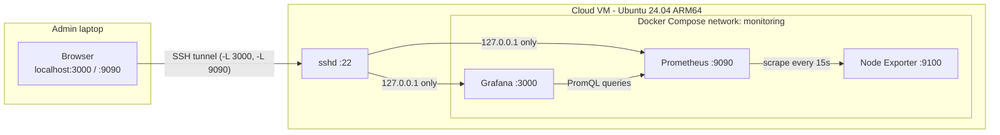
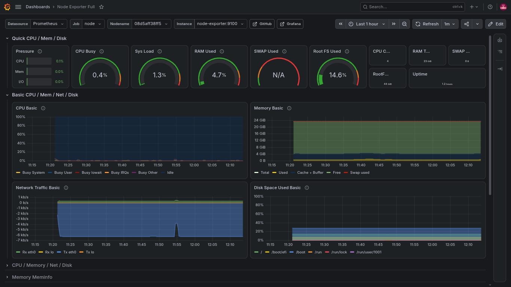
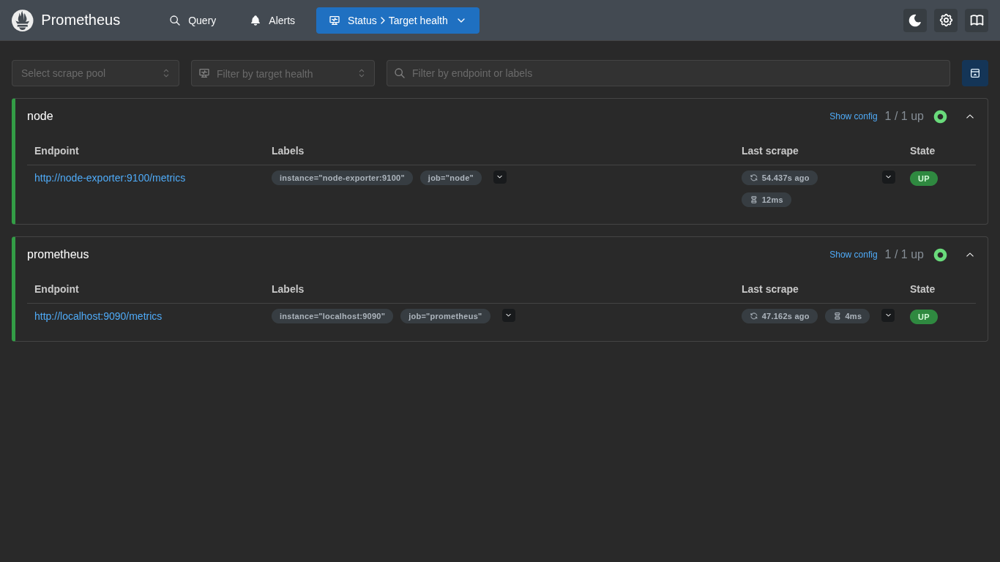

# Cloud Monitoring Platform

A self-hosted monitoring stack for a cloud VM: **Prometheus** collects metrics, **Node Exporter** exposes host metrics, and **Grafana** visualises them. Everything runs with Docker Compose, and the admin UIs are reachable **only through an SSH tunnel**. No monitoring port is exposed to the internet.

> Part 1 of a two-project DevOps portfolio. Part 2 adds CI/CD with GitHub Actions and secure automated deployment to the same server.

## Architecture



## Stack

| Component | Version | Role |
|---|---|---|
| Prometheus | v3.15.1 | Metrics collection and storage (15 days retention) |
| Node Exporter | v1.12.1 | CPU, memory, disk and load metrics of the host |
| Grafana | 13.2.4 | Dashboards; datasource provisioned as code |
| Docker Compose | plugin | Runs and wires the services together |

Tested on an Oracle Cloud Infrastructure VM (Ubuntu Server 24.04 LTS, ARM64, 4 cores, 23 GB RAM). All images are multi-arch.

## Features

- One-command deployment with `docker compose up -d`
- Persistent named volumes for Prometheus data and Grafana state
- Grafana datasource provisioned from a file, with a dashboard provider ready for JSON dashboards
- Pinned image versions for reproducible runs
- Admin UIs bound to `127.0.0.1` and accessed through an SSH tunnel

## Quick start

On the server (Docker Engine and the Compose plugin required):

```bash
git clone https://github.com/talnuerhwork/cloud-monitoring-platform.git
cd cloud-monitoring-platform

cp .env.example .env
# set a strong password, for example:
echo "GRAFANA_ADMIN_PASSWORD=$(openssl rand -base64 18 | tr -d '/+=')" > .env
chmod 600 .env

docker compose up -d
docker compose ps
curl -s http://127.0.0.1:9090/api/v1/targets | grep -o '"health":"[a-z]*"'   # expect two "up"
```

From your laptop, open the tunnel (leave it running):

```bash
ssh -i <path-to-key> -L 3000:127.0.0.1:3000 -L 9090:127.0.0.1:9090 -N <user>@<SERVER_IP>
```

Then browse to `http://localhost:3000`, sign in as `admin` with the password from `.env`, and import the **Node Exporter Full** dashboard: *Dashboards > New > Import*, ID `1860`, then pick the Prometheus datasource.

## Screenshots





## What the dashboard shows

| Signal | Underlying metric | Why it matters |
|---|---|---|
| CPU busy | `node_cpu_seconds_total` | Sustained values above ~85-90% mean saturation |
| Memory used | `node_memory_MemAvailable_bytes` | Based on available memory, not "free": Linux uses spare RAM for cache |
| Disk used | `node_filesystem_avail_bytes` | Alert before the root filesystem fills up |
| System load | `node_load1` | Compare against the number of cores |

## Security design

- **Loopback-only ports.** Grafana and Prometheus are published as `127.0.0.1:PORT:PORT`. Docker-published ports bypass the host's INPUT firewall rules, so a plain `3000:3000` would expose Grafana to the internet even with a restrictive host firewall.
- **No port for Node Exporter.** Prometheus reaches it over the internal Docker network only.
- **Secrets stay out of Git.** The Grafana admin password lives in `.env` (git-ignored). Compose fails fast if it is missing. Only `.env.example` is committed.
- **Read-only mounts** for configuration files and for the host filesystem used by Node Exporter.
- **Pinned versions** instead of `latest`.

## Known limitations

- Node Exporter runs on the Docker bridge network, so CPU, memory and disk panels describe the host, but network panels describe the container's network, not the host's.
- No alerting or TLS yet. Access control relies on the SSH tunnel.
- Single node, with 15 days of metric retention.

## Roadmap

- [x] Project 1: monitoring platform (this repository)
- [ ] Alert rules (disk above 85%, target down) with Alertmanager
- [ ] Project 2: CI/CD with GitHub Actions and secure automated deployment

## Skills demonstrated

Docker and Docker Compose, Prometheus and Grafana, Linux server administration, firewall-aware container networking, SSH tunneling, secrets handling, infrastructure as code (provisioning), and technical documentation.

## License

MIT, see [LICENSE](LICENSE).
